# UX_MAPPING.md — CRM Contable (Grupo 5)

> **Fuente de verdad** para conectar las pantallas de Google Stitch con el frontend Next.js y los servicios web desplegados en Cloud Run.
>
> | Fuente | Qué aporta |
> |---|---|
> | `UX_Mapping.pdf` (17 páginas) | Flujos, las 6 vistas UI, errores HTTP y soluciones RCE (Radical Client Experience) |
> | `UX.zip` (40 pantallas de Stitch) | Nombres exactos de pantalla, elementos interactivos y textos |
> | `bruno.zip` (162 peticiones) | Rutas, cuerpos, códigos de respuesta y campos de respuesta **reales** del backend |
>
> **Regla de precedencia:** cuando el PDF y la API no coinciden, **manda la API desplegada**. Cada diferencia está marcada con ❗ y resumida en la [§5 Conflictos PDF ↔ API](#5-conflictos-pdf--api).

### Leyenda de marcadores

| Marcador | Significado |
|---|---|
| ✅ | Ruta, cuerpo o código **verificado** en la colección Bruno |
| ⚠️ | El PDF o Stitch lo piden, pero **no aparece** en la colección. Hay que confirmarlo en el Swagger de NestJS antes de programar |
| ❗ | **Conflicto**: el PDF o Stitch dicen una cosa y la API hace otra. Se programa según la API |
| `⚠️ SIN ENDPOINT` | La acción de UI no tiene servicio. Ver [§6 Brechas](#6-brechas-detectadas) |

---

## 1. Configuración global

### 1.1 Variables de entorno

El frontend es **Next.js (App Router)**, así que la variable es `NEXT_PUBLIC_API_URL`. La URL **ya incluye** el prefijo `/api/v1`.

```bash
# .env.local  (backend corriendo en local contra Cloud SQL)
NEXT_PUBLIC_API_URL=http://localhost:3000/api/v1

# .env.production  (backend publicado en Cloud Run · proyecto crm-cloud-506523)
NEXT_PUBLIC_API_URL=https://crm-contable-api-916812392845.us-east1.run.app/api/v1
```

> Si más adelante se pone **API Gateway** delante de Cloud Run, solo cambia esta variable. El backend debe permitir por **CORS** el origen del frontend (dominio de Cloud Run o Firebase Hosting del front).

### 1.2 Cliente HTTP base

Todas las pantallas consumen la API a través de un único cliente:

```ts
// lib/api.ts
export const API_URL = process.env.NEXT_PUBLIC_API_URL!;

export interface ProblemDetails {          // RFC 9457 · application/problem+json ✅
  type: string;                            // p. ej. ".../stock-insuficiente"
  title: string;                           // p. ej. "Stock insuficiente"
  status?: number;
  detail?: string;                         // mensaje legible para el usuario
  instance: string;                        // ruta que falló
  errors?: unknown[];                      // solo en 400 de validación de DTO ✅ (estructura interna ⚠️ confirmar)
}

export class ApiError extends Error {
  constructor(public status: number, public problem: ProblemDetails) { super(problem.detail ?? problem.title); }
  get kind() { return this.problem.type?.split('/').pop(); } // "stock-insuficiente", "credito-bloqueado", "periodo-cerrado"...
}

type Opts = RequestInit & { idempotencyKey?: string; raw?: boolean };

export async function api<T>(path: string, opts: Opts = {}): Promise<T> {
  const token = getAccessToken();                       // memoria + sessionStorage (ver 1.3)
  const headers = new Headers(opts.headers);
  if (token) headers.set('Authorization', `Bearer ${token}`);
  if (opts.body && !(opts.body instanceof FormData)) headers.set('Content-Type', 'application/json');
  if (opts.idempotencyKey) headers.set('Idempotency-Key', opts.idempotencyKey);

  const res = await fetch(`${API_URL}${path}`, { ...opts, headers });

  if (res.status === 401 && !path.startsWith('/auth/')) {
    saveDraftsBeforeLeaving();                          // pilar RCE "Cero pérdida de datos"
    clearSession();
    location.assign(`/auth/login?next=${encodeURIComponent(location.pathname)}`);
  }
  if (!res.ok) {
    const problem = res.headers.get('content-type')?.includes('json')
      ? await res.json() : { type: 'about:blank', title: res.statusText, instance: path };
    throw new ApiError(res.status, problem);
  }
  if (opts.raw) return res as unknown as T;             // PDFs, CSV, adjuntos
  return res.status === 204 ? (undefined as T) : res.json();
}
```

| Código | Comportamiento global del cliente |
|---|---|
| **401** (fuera de `/auth/*`) | El token falta o venció. Guarda borradores, limpia la sesión y redirige a `1.1 · Login normal` con `?next=` |
| **403** | **No** redirige. La pantalla muestra el aviso en línea o navega a `1.6 · Acceso denegado · Error 403 RBAC` si es una ruta completa |
| **404** | Para un Usuario puede significar "no existe" **o** "pertenece a otro usuario" (pagos, gastos y jobs ajenos devuelven 404, no 403 ✅). El texto debe decir *"No encontramos este registro o no tienes acceso a él"* |
| **429** | Bloqueo por IP durante ~60 s (login fallido 11 veces ✅). Deshabilita el botón y muestra cuenta regresiva |
| **5xx / red caída** | Banner con **Reintentar**, conservando los datos del formulario |

### 1.3 Autenticación y sesión

| Tema | Regla |
|---|---|
| Login | `POST /auth/login` con `{ email, password }` ✅ |
| Token | `accessToken` (JWT HS256) que **dura 15 minutos** ✅. No se encontró un endpoint de refresh ⚠️ |
| Claims del JWT | `sub` (UUID del usuario), `email`, `rol` (`"ADMIN"` \| `"USUARIO"`), `permisos: string[]`, `iat`, `exp` ✅ |
| Perfil | `GET /auth/me` → `{ permisos: string[], ... }` ✅. Se llama al cargar la app para hidratar el menú |
| Almacenamiento | Token en memoria y copia en `sessionStorage` (no `localStorage`). La UI programa un aviso a los 13 min: *"Tu sesión vence en 2 min. Guarda tu trabajo"* |
| Gating de UI | Por **permiso**, no por nombre de rol: `can('ventas.anular')`. Así se soporta RBAC granular sin cambiar el front |

### 1.4 Errores RFC 9457 → UI

Todas las respuestas de error son `application/problem+json` con `type`, `title`, `detail` e `instance` ✅. La UI decide **por `status` + sufijo de `type`**:

| `status` · `type` (sufijo) | Origen verificado | Tratamiento RCE |
|---|---|---|
| 400 · validación de DTO (`errors[]`) | `POST /clientes` con campos inválidos ✅ | Borde rojo en cada campo de `errors[]`, foco en el primero y se conserva el resto del formulario |
| 400 · motivo faltante | anular/reabrir sin `motivo` ✅, entrada de inventario sin `motivo` ✅ | Campo `motivo` obligatorio en rojo dentro del modal |
| 401 · credenciales | `POST /auth/login` ✅. `detail` siempre es `"Correo o contraseña incorrectos"` (no revela si el correo existe) | Mantiene correo e identificación y ofrece **Restablecer contraseña** |
| 403 · sin permiso | rutas de Administrador con token de Usuario ✅ | Aviso en línea o `1.6` (ver 1.2) |
| 404 · no encontrado o ajeno | ✅ | Empty state con CTA (crear o volver) |
| 409 · `stock-insuficiente` (`title: "Stock insuficiente"`) | `POST /facturas-venta` ✅ | Muestra el disponible, ofrece **Ajustar cantidad** o **Registrar entrada** |
| 409 · conflicto de estado o duplicado | documento duplicado, factura de compra duplicada, anular dos veces, nómina duplicada o pagada, transición de pedido inválida, cotización aprobada, bodega o producto con stock, consecutivo hacia atrás, conteo ya cerrado ✅ | Explica el estado actual y da un botón a la entidad existente |
| 413 · archivo muy grande | ⚠️ (PDF/Stitch; no está en Bruno) | Validar `file.size` **antes** de subir |
| 415 · contenido no coincide con la extensión | adjunto `.pdf` falso ✅ | *"El archivo no es un PDF válido"* y deja elegir otro |
| 422 · `credito-bloqueado` | venta a crédito con crédito bloqueado ✅ | Opciones **Cambiar a contado** / **Solicitar autorización de cupo** |
| 422 · `periodo-cerrado` | gasto con fecha en mes cerrado ✅ | *"El periodo AAAA-MM está cerrado"* y **Solicitar reapertura** (Administrador) |
| 422 · regla de negocio | pago mayor al saldo ✅, XML con DOCTYPE (XXE) ✅, cerrar el mes en curso ✅, misma Idempotency-Key con otro cuerpo ✅, envío de cotización sin correo configurado ✅ | `detail` en el banner y se conserva el formulario |
| 429 | login ✅ | Cuenta regresiva de 60 s |
| 500 / 502 / 503 | `GET /health/ready` puede dar 503 ⚠️ | Banner *"Mostramos la última lectura guardada"* y **Reintentar** |

### 1.5 Idempotencia (doble clic y reintentos)

Endpoints que aceptan el header `Idempotency-Key` ✅:

| Endpoint | Uso |
|---|---|
| `POST /facturas-venta` | crear remisión |
| `POST /pedidos/{id}/facturar` | remisión desde pedido |
| `POST /facturas-compra` | registrar compra |
| `POST /pagos` | registrar pago |

Reglas:
1. Genera `crypto.randomUUID()` **al abrir el formulario** (no al enviar) y guárdalo junto al borrador.
2. Reutiliza la **misma** clave en cada reintento del mismo intento (timeout, 5xx o doble clic).
3. Si la respuesta trae el header `idempotent-replayed: true` ✅, la operación **ya existía**: muestra *"Este documento ya fue registrado"* con el mismo número y **no** dupliques.
4. Si responde **422** con la misma clave y otro cuerpo ✅, el usuario cambió datos tras un fallo. Genera una clave nueva y pide confirmación.
5. Renueva la clave solo después de un 2xx.

> ❗ El PDF habla de **"409 Idempotency-Key"**. La API real **no** responde 409 en este caso: devuelve **201 con `idempotent-replayed: true`** para la repetición y **422** si cambió el cuerpo.

### 1.6 Listados y paginación

- Parámetro `?limit=N` ✅. Respuesta paginada: `{ data: T[], meta: { total: number, ... } }` ✅
- Filtros vistos: `clienteId`, `proveedorId`, `tipoPago`, `resultado`, `dias`, `q` ✅
- Parámetro de página u offset: ⚠️ no aparece en Bruno. Confirmar (`page` u `offset`) en el Swagger.
- Catálogos pequeños (`/bodegas`, `/medios-pago`, `/categorias-gasto`, `/tipos-documento`, `/roles`, `/periodos-contables`) devuelven **arreglo plano** sin `meta` ✅.

### 1.7 Archivos

| Tipo | Regla |
|---|---|
| Subida | `multipart/form-data` con el campo **`archivo`** ✅ (`FormData.append('archivo', file)`). No pongas `Content-Type` a mano |
| Descarga (PDF/CSV) | Las rutas `/pdf`, `/recibo`, `/desprendibles`, `/adjuntos/{id}`, `/soporte`, `/jobs/{id}/descargar` exigen Bearer. Usa `fetch` + `blob()` + `URL.createObjectURL`. **No** uses `<a href>` directo |
| Archivos de prueba | `bruno/archivos/` trae `factura-proveedor.xml`, `factura-prueba.pdf`, `recibo.jpg` y `logo.png` para probar las pantallas |

### 1.8 Convenciones de datos

| Tema | Regla |
|---|---|
| IDs | UUID v4 en todas las entidades ✅ |
| Fechas | `YYYY-MM-DD` en hora de Colombia (UTC-5). Periodos contables: `YYYY-MM` ✅ |
| Dinero | Llega como `number` (p. ej. `total: 107100`, `reteica: 869.4`) ✅. Algunos campos `NUMERIC` pueden llegar como string (`cupoCredito` se convierte con `Number()` en Bruno). Normaliza con `Number()` al leer y muestra con `Intl.NumberFormat('es-CO', { style: 'currency', currency: 'COP', maximumFractionDigits: 0 })` |
| Porcentajes | `pctIva: 19`, `pctDescuento: 10`, `pctRetefuente: 2.5`, `tarifaReteIcaPorMil: 9.66` (enteros o decimales, no fracciones) ✅ |
| Mayúsculas y minúsculas | Casi todo es **camelCase**. Excepciones ✅: conteos (`id_conteo`, `items[].id_producto`, `stock_sistema`) y periodos (`id_periodo`, `anio`, `mes`). Mapea con un adaptador |
| Consecutivos | Remisión `REM-000001`, cotización `COT-…`, pedido `PED-…` ✅ |
| Idioma y formato | Español, COP, `DD/MM/AAAA` en pantalla |

### 1.9 Reglas globales de los 4 estados

Aplican a **todas** las pantallas, salvo que su sección diga otra cosa:

| Estado | Regla global |
|---|---|
| **Loading** | Skeleton con la forma del componente (KPI, tabla, panel). Los botones de envío muestran spinner y quedan `disabled` hasta la respuesta, la primera defensa contra el doble clic. Si una carga pasa de 10 s, muestra *"Esto está tardando más de lo normal"* y **Reintentar** |
| **Success** | Mutación: toast verde con el número del documento (`REM-000123`), refresco del listado afectado y limpieza del borrador local. Lectura: contenido normal |
| **Empty State** | Ilustración + mensaje en segunda persona + CTA primaria acorde al permiso. Si el usuario no tiene el permiso de crear, el CTA se oculta |
| **Error** | Banner superior rojo con el formato de Stitch (`Error {status}: {title}` + `detail` + **acción RCE** a la derecha). Errores por campo bajo el input. **Nunca** se borran los datos digitados |

### 1.10 Matriz de permisos (JWT real)

| Permiso | USUARIO | ADMIN |
|---|:-:|:-:|
| `ventas.consultar` · `ventas.crear` | ✔ | ✔ |
| `ventas.anular` | — | ✔ |
| `compras.consultar` · `compras.crear` | ✔ | ✔ |
| `compras.anular` | — | ✔ |
| `inventario.consultar` · `inventario.movimientos` | ✔ | ✔ |
| `inventario.ajustar` · `inventario.costos` | — | ✔ |
| `productos.crear` · `productos.editar` | ✔ | ✔ |
| `productos.precios` · `productos.eliminar` · `productos.importar` | — | ✔ |
| `terceros.consultar` · `terceros.crear` · `terceros.editar` | ✔ | ✔ |
| `terceros.eliminar` · `terceros.importar` · directorio completo (`GET /clientes`, `GET /proveedores`) | — | ✔ |
| `cartera.consultar` · `pagos.registrar` | ✔ | ✔ |
| `cartera.gestionar` · `pagos.anular` (incluye cupo y bloqueo de crédito) | — | ✔ |
| `gastos.registrar` | ✔ | ✔ |
| `gastos.consultar_todos` · `gastos.anular` | — | ✔ |
| `reportes.exportar` | ✔ | ✔ |
| `reportes.financieros` (dashboard global, ventas, compras, rentabilidad, estado de resultados, valorizado) | — | ✔ |
| `empleados.*` · `nomina.*` | — | ✔ |
| `cierres.ejecutar` · `auditoria.consultar` · `consecutivos.gestionar` · `catalogos.gestionar` · `configuracion.gestionar` · `usuarios.gestionar` · `roles.gestionar` · `mantenimiento.gestionar` | — | ✔ |

> ❗ Stitch muestra roles como `AUX_CONTABLE`, `ADMIN_CONTABLE` o "Auxiliar de inventario". El backend solo tiene **`ADMIN`** y **`USUARIO`** (`GET /roles` → `codigo`) ✅. En la UI se muestran como **Administrador** y **Usuario**.

---

## 2. Flujo y enrutamiento

### 2.1 Vistas extraídas del PDF

| Pág. PDF | Sección | Tipo |
|---|---|---|
| 2 | Pilares RCE: Prevención proactiva · Cero pérdida de datos · Recuperación guiada | Principios |
| 3 | Capas por servicio: Acción del usuario → Frontstage UI → Backstage API → Respuesta RCE | Metodología |
| 4 | Tabla Autenticación, Usuarios y RBAC | Mapeo de errores |
| 5 | **Pantalla 01** · Autenticación y recuperación (Login, 400, 401) | **Vista UI** |
| 6 | Manejo de errores reales: NIT 400 · NIT 409 · Bloqueo 422 · CSV 400 | Mapeo de errores |
| 7 | **Pantalla 02** · Directorio de terceros y cupo (cliente 400/409/422) | **Vista UI** |
| 8 | Tabla Inventario, bodegas y conteos | Mapeo de errores |
| 9 | **Pantalla 03** · Inventario, bodegas y equivalencias (Kardex, conteo, stock) | **Vista UI** |
| 10 | Cotización → Pedido → Factura y protección de la venta | Flujo transaccional |
| 11 | **Pantalla 04** · Facturación y pedidos (422 cupo, 502 DIAN) | **Vista UI** |
| 12 | Compras XML, cartera y pagos | Mapeo de errores |
| 13 | **Pantalla 05** · Compras XML y tesorería con idempotencia | **Vista UI** |
| 14 | Tabla Nómina, cierres, jobs y Siigo | Mapeo de errores |
| 15 | **Pantalla 06** · Cierre contable, nómina y conector Siigo | **Vista UI** |
| 16 | Alcance: 14 módulos · 48+ tablas · 9 códigos HTTP · 100 % RCE | Resumen |

### 2.2 Diagrama de flujo

```mermaid
flowchart TD
  %% ---------- PANTALLA 01 · Autenticación ----------
  subgraph P01["Pantalla 01 · Autenticación y recuperación"]
    L["1.1 · Login normal"]
    L2["1.2 · Login campos incompletos · Error 400"]
    L3["1.3 · Login contraseña incorrecta · Error 401"]
    F["1.4 · Solicitar restablecer contraseña"]
    R["1.5 · Nueva contraseña"]
    R1["1.5a · Nueva contraseña · Error 400 no coinciden"]
    R2["1.5b · Nueva contraseña · Error 400 token expirado"]
    X["1.6 · Acceso denegado · Error 403 RBAC"]
  end

  L -->|"Ingresar con campos vacíos"| L2
  L2 -->|"Corregir"| L
  L -->|"POST /auth/login → 401"| L3
  L3 -->|"Restablecer contraseña"| F
  L -->|"Restablecer contraseña"| F
  L -->|"429 · 60 s de espera"| L
  F -->|"POST /auth/forgot-password → correo con enlace"| R
  F -->|"Volver a Ingresar"| L
  R -->|"Confirmación distinta (cliente)"| R1
  R1 -->|"Corregir"| R
  R -->|"POST /auth/reset-password → 400"| R2
  R2 -->|"Solicitar un nuevo enlace"| F
  R -->|"200 · contraseña cambiada"| L
  L -->|"200 · accessToken"| D

  %% ---------- Shell de la aplicación ----------
  D["2.1 · Dashboard · Normal"]
  D -. "503" .-> DE["2.1E · Dashboard · Error"]
  D -->|"menú Clientes"| C["2.2 · Clientes · Normal"]
  D -->|"menú Proveedores"| PV["2.3 · Proveedores · Normal"]
  D -->|"menú Inventario"| I["2.4 · Inventario · Normal"]
  D -->|"menú Facturación"| FA["2.5 · Facturación · Normal"]
  D -->|"menú Contabilidad"| CO["2.6 · Contabilidad · Normal"]
  D -->|"Configuración"| H1
  D -->|"Nueva factura"| FA
  D -->|"Registrar pago"| E1
  D -->|"Registrar movimiento de inventario"| I

  %% ---------- PANTALLA 02 · Terceros ----------
  subgraph P02["Pantalla 02 · Terceros y cupo"]
    C -. "400" .-> CE["2.2E · Clientes · Error"]
    C -->|"Ver cuenta"| A1["A1 · Servicio Terceros y Crédito · Vista Normal"]
    A1 -. "400 / 409 / 422" .-> A2["A2 · Servicio Terceros · Errores 400, 409 y 422"]
    A2 -->|"Ver tercero existente"| A1
    PV -. "409" .-> PVE["2.3E · Proveedores · Error"]
  end

  %% ---------- PANTALLA 03 · Inventario ----------
  subgraph P03["Pantalla 03 · Inventario, Kardex y conteo"]
    I -. "409 stock" .-> IE["2.4E · Inventario · Error"]
    IE -->|"Registrar entrada"| I
    I -->|"seleccionar repuesto"| B1["B1 · Servicio Inventario, Kardex y Conteo Físico · Vista Normal"]
    B1 -. "409 / 400 / 409" .-> B2["B2 · Servicio Inventario · Errores 400, 409 y 422"]
    B2 -->|"Ver existencias"| B1
  end

  %% ---------- PANTALLA 04 · Ventas ----------
  subgraph P04["Pantalla 04 · Cotización → Pedido → Remisión"]
    FA -. "422" .-> FAE["2.5E · Facturación · Error"]
    FA -->|"Nueva cotización"| C1["C1 · Servicio Ventas, Cotizaciones, Pedidos y Factura DIAN · Vista Normal"]
    C1 -->|"convertir-pedido"| C1
    C1 -->|"facturar → REM"| FA
    C1 -. "422 cupo / 5xx" .-> C2["C2 · Servicio Ventas · Errores 400, 422 y 502 DIAN"]
    C2 -->|"Cambiar a contado"| C1
  end

  %% ---------- PANTALLA 05 · Compras y tesorería ----------
  subgraph P05["Pantalla 05 · Compras XML y tesorería"]
    PV -->|"Ver compras"| D1["D1 · Compras e Importación XML · Vista Normal"]
    D1 -. "400 / 409 / 413 / 415 / 422" .-> D2["D2 · Compras e Importación XML · Errores 400, 409 y 413"]
    D2 -->|"Volver al borrador"| D1
    E1["E1 · Cartera y Tesorería · Vista Normal"]
    E1 -. "422 / replay / 400" .-> E2["E2 · Cartera y Tesorería · Errores 400, 409 y 422"]
  end
  CO -->|"Cartera"| E1

  %% ---------- PANTALLA 06 · Cierre, nómina, Siigo ----------
  subgraph P06["Pantalla 06 · Cierre, nómina y Siigo"]
    F1["F1 · Nómina y Empleados · Vista Normal"]
    F1 -. "400 / 409" .-> F2["F2 · Nómina y Empleados · Errores 400 y 409"]
    G1["G1 · Reportes, Cierre, Auditoría y RBAC · Vista Normal"]
    G1 -. "403 / 422 / 500 / 503" .-> G2["G2 · Reportes, Cierre, Auditoría y RBAC · Errores 403, 422, 500 y 503"]
    G2 -->|"Ir a facturas"| FA
    G2 -->|"Ir a conteos"| B1
    J1["J1 · Servicio Integración Siigo y Reversas Contables · Vista Normal"]
    J1 -. "422 periodo cerrado" .-> J2["J2 · Integración Siigo y Reversas · Errores 422, 502 y 401"]
    J2 -->|"Solicitar reapertura"| G1
  end
  CO -->|"Nómina"| F1
  CO -->|"Reportes y cierre"| G1
  CO -->|"Siigo y reversas"| J1

  %% ---------- Configuración (sin vista propia en el PDF) ----------
  H1["H1 · Servicio Usuarios, Sesiones Activas y Roles RBAC · Vista Normal"]
  H1 -. "400 / 409 / 429" .-> H2["H2 · Usuarios, Sesiones y Roles · Errores 400, 409 y 429"]
  H1 -->|"Catálogos"| I1["I1 · Catálogos Maestros, Consecutivos, Resoluciones e Importación · Vista Normal"]
  I1 -. "400 / 404 / 409" .-> I2["I2 · Catálogos e Importación · Errores 400, 404 y 422"]
  CO -. "422 periodo" .-> COE["2.6E · Contabilidad · Error"]

  %% ---------- 403 transversal ----------
  C & PV & I & FA & CO & H1 & F1 & G1 -. "403 sin permiso" .-> X
  X -->|"Volver al Inicio"| D
```



> Las pantallas **E** (2.xE), **A2**, **B2**, **C2**, **D2**, **E2**, **F2**, **G2**, **H2**, **I2** y **J2** **no son rutas**: son **estados de error** de la misma ruta que su par "Normal". Se implementan como variantes del mismo componente.

### 2.3 Tabla de enrutamiento

| Vista en PDF (pág.) | Pantalla en Google Stitch (nombre exacto) | Ruta Next.js | Roles permitidos | Módulo |
|---|---|---|---|---|
| Pantalla 01 (p. 4–5) | `1.1 · Login normal` | `/auth/login` | Público | Auth |
| Pantalla 01 (p. 4–5) | `1.2 · Login campos incompletos · Error 400` | `/auth/login` *(estado)* | Público | Auth |
| Pantalla 01 (p. 4–5) | `1.3 · Login contraseña incorrecta · Error 401` | `/auth/login` *(estado)* | Público | Auth |
| Pantalla 01 (p. 5) | `1.4 · Solicitar restablecer contraseña` | `/auth/forgot-password` | Público | Auth |
| Pantalla 01 (p. 4) | `1.5 · Nueva contraseña` | `/auth/reset-password?token=…` | Público (con token) | Auth |
| Pantalla 01 (p. 4) | `1.5a · Nueva contraseña · Error 400 no coinciden` | `/auth/reset-password` *(estado)* | Público | Auth |
| Pantalla 01 (p. 4) | `1.5b · Nueva contraseña · Error 400 token expirado` | `/auth/reset-password` *(estado)* | Público | Auth |
| Pantalla 01 (p. 4, "Modal Bloqueo RBAC") | `1.6 · Acceso denegado · Error 403 RBAC` | `/acceso-denegado` | Autenticado | Auth |
| — *(sin vista en PDF)* | `2.1 · Dashboard · Normal` | `/dashboard` | Admin (resumen global) · Usuario (vista reducida) | Reportes |
| — | `2.1E · Dashboard · Error` | `/dashboard` *(estado)* | Admin · Usuario | Reportes |
| Pantalla 02 (p. 6–7) | `2.2 · Clientes · Normal` | `/clientes` | Admin (directorio) · Usuario (búsqueda) | Terceros |
| Pantalla 02 (p. 6–7) | `2.2E · Clientes · Error` | `/clientes` *(estado)* | Admin · Usuario | Terceros |
| Pantalla 02 (p. 6–7) | `A1 · Servicio Terceros y Crédito · Vista Normal` | `/clientes/[id]` | Admin · Usuario (crédito solo lectura) | Terceros |
| Pantalla 02 (p. 6–7) | `A2 · Servicio Terceros · Errores 400, 409 y 422` | `/clientes/[id]` y `/clientes/nuevo` *(estado)* | Admin · Usuario | Terceros |
| Pantalla 02 (p. 6) | `2.3 · Proveedores · Normal` | `/proveedores` | Admin (directorio) · Usuario (búsqueda) | Terceros |
| Pantalla 02 (p. 6) | `2.3E · Proveedores · Error` | `/proveedores` *(estado)* | Admin · Usuario | Terceros |
| Pantalla 03 (p. 8–9) | `2.4 · Inventario · Normal` | `/inventario` | Admin · Usuario (sin costos) | Inventario |
| Pantalla 03 (p. 8–9) | `2.4E · Inventario · Error` | `/inventario` *(estado)* | Admin · Usuario | Inventario |
| Pantalla 03 (p. 8–9) | `B1 · Servicio Inventario, Kardex y Conteo Físico · Vista Normal` | `/inventario/[idProducto]` | Admin · Usuario (conteo y ajuste solo Admin) | Inventario |
| Pantalla 03 (p. 8–9) | `B2 · Servicio Inventario · Errores 400, 409 y 422` | `/inventario/[idProducto]` *(estado)* | Admin · Usuario | Inventario |
| Pantalla 04 (p. 10–11) | `2.5 · Facturación · Normal` | `/facturacion/nueva` y `/facturacion/[id]` | Admin · Usuario | Ventas |
| Pantalla 04 (p. 10–11) | `2.5E · Facturación · Error` | `/facturacion/*` *(estado)* | Admin · Usuario | Ventas |
| Pantalla 04 (p. 10–11) | `C1 · Servicio Ventas, Cotizaciones, Pedidos y Factura DIAN · Vista Normal` | `/facturacion/ventas` (`?cotizacion=` / `?pedido=`) | Admin · Usuario | Ventas |
| Pantalla 04 (p. 10–11) | `C2 · Servicio Ventas · Errores 400, 422 y 502 DIAN` | `/facturacion/ventas` *(estado)* | Admin · Usuario | Ventas |
| Pantalla 05 (p. 12–13) | `D1 · Compras e Importación XML · Vista Normal` | `/proveedores/compras/nueva` y `/proveedores/compras/[id]` | Admin · Usuario | Compras |
| Pantalla 05 (p. 12–13) | `D2 · Compras e Importación XML · Errores 400, 409 y 413` | `/proveedores/compras/*` *(estado)* | Admin · Usuario | Compras |
| Pantalla 05 (p. 12–13) | `E1 · Cartera y Tesorería · Vista Normal` | `/contabilidad/cartera` | Admin (global) · Usuario (por tercero) | Cartera y tesorería |
| Pantalla 05 (p. 12–13) | `E2 · Cartera y Tesorería · Errores 400, 409 y 422` | `/contabilidad/cartera` *(estado)* | Admin · Usuario | Cartera y tesorería |
| Pantalla 06 (p. 14–15) | `F1 · Nómina y Empleados · Vista Normal` | `/contabilidad/nomina` | **Solo Admin** | Nómina |
| Pantalla 06 (p. 14–15) | `F2 · Nómina y Empleados · Errores 400 y 409` | `/contabilidad/nomina` *(estado)* | Solo Admin | Nómina |
| Pantalla 06 (p. 14–15) | `G1 · Reportes, Cierre, Auditoría y RBAC · Vista Normal` | `/contabilidad/cierre` | **Solo Admin** | Cierre y reportes |
| Pantalla 06 (p. 14–15) | `G2 · Reportes, Cierre, Auditoría y RBAC · Errores 403, 422, 500 y 503` | `/contabilidad/cierre` *(estado)* | Solo Admin | Cierre y reportes |
| Pantalla 06 (p. 14–15) | `J1 · Servicio Integración Siigo y Reversas Contables · Vista Normal` | `/contabilidad/siigo` | **Solo Admin** | Siigo y anulaciones |
| Pantalla 06 (p. 14–15) | `J2 · Integración Siigo y Reversas · Errores 422, 502 y 401` | `/contabilidad/siigo` *(estado)* | Solo Admin | Siigo y anulaciones |
| — *(sin vista en PDF)* | `2.6 · Contabilidad · Normal` | `/contabilidad` | Solo Admin | Contabilidad |
| — | `2.6E · Contabilidad · Error` | `/contabilidad` *(estado)* | Solo Admin | Contabilidad |
| p. 4 (filas `/roles`) | `H1 · Servicio Usuarios, Sesiones Activas y Roles RBAC · Vista Normal` | `/configuracion/usuarios` | **Solo Admin** | Usuarios y RBAC |
| p. 4 (filas `/roles`) | `H2 · Usuarios, Sesiones y Roles · Errores 400, 409 y 429` | `/configuracion/usuarios` *(estado)* | Solo Admin | Usuarios y RBAC |
| p. 6 ("CSV masivo") | `I1 · Catálogos Maestros, Consecutivos, Resoluciones e Importación · Vista Normal` | `/configuracion/catalogos` | **Solo Admin** | Catálogos |
| p. 6 ("CSV masivo") | `I2 · Catálogos e Importación · Errores 400, 404 y 422` | `/configuracion/catalogos` *(estado)* | Solo Admin | Catálogos |

**Protección de rutas** (`middleware.ts`): sin token → `/auth/login?next=`. Con token sin el permiso de la ruta → `/acceso-denegado?servicio=<módulo>`. El menú lateral oculta **Configuración** y los submódulos de Contabilidad marcados *Solo Admin* cuando el usuario no es Administrador.

---

## 3. Mapeo detallado por pantalla

Formato de cada acción: **Acción → Endpoint → Request → Response (2xx) → Errores y respuesta RCE**.

---

### 3.1 Pantalla 01 · Autenticación y recuperación

**Pantallas Stitch:** `1.1`, `1.2`, `1.3`, `1.4`, `1.5`, `1.5a`, `1.5b`, `1.6`
**PDF:** p. 4 (tabla) y p. 5 (vista UI). Pilar RCE: *"No borra el NIT ni el correo digitado y ofrece recuperación en 1 clic."*

#### Elementos interactivos

| Elemento (Stitch) | Pantalla | Acción |
|---|---|---|
| Input **Identificación** (*"sin puntos ni espacios"*) | 1.1, 1.4 | Solo cliente: limpia puntos, guiones y espacios. ❗ La API **no** recibe identificación (ver nota) |
| Input **Correo** | 1.1, 1.4 | Validación de formato en `blur` |
| Input **Contraseña** + ojo | 1.1 | Mostrar u ocultar |
| Checkbox **Recordar mi identificación** | 1.1 | Guarda identificación y correo en `localStorage` (nunca la contraseña) |
| Link **Restablecer contraseña** | 1.1, 1.3 | Navega a `/auth/forgot-password` llevando el correo digitado |
| Botón **Ingresar** | 1.1 | `POST /auth/login` |
| Botón **Recibir enlace de recuperación** | 1.4 | `POST /auth/forgot-password` |
| Inputs **Nueva contraseña** / **Confirmar contraseña** + medidor de seguridad | 1.5 | Reglas: ≥ 8 caracteres, mayúscula, minúscula, número y símbolo |
| Botón **Guardar nueva contraseña** | 1.5 | `POST /auth/reset-password` |
| Botón **Solicitar un nuevo enlace** | 1.5b | Navega a `1.4` |
| Botones **Volver al Inicio** / **Solicitar permisos** | 1.6 | `/dashboard` · `⚠️ SIN ENDPOINT` (solicitud de permiso) |
| Links **Ayuda**, **Hablar con soporte de acceso** | todas | Enlaces externos |

> ❗ **Identificación (NIT/CC):** Stitch y el PDF piden identificación + correo + clave. La API autentica **solo con `email` y `password`** ✅. Opciones: (a) quitar el campo, o (b) dejarlo como dato de UX sin enviarlo. **Recomendado: (a)**, o pedir al backend que lo valide.

#### Acción: Iniciar sesión — `POST /auth/login` ✅

```jsonc
// Request
{ "email": "admin@crmcontable.com", "password": "********" }

// 200 OK
{
  "accessToken": "eyJhbGciOiJIUzI1NiIs...",   // dura 15 min
  "user": {
    "permisos": ["ventas.consultar", "ventas.crear", "..."]
    // id, email y rol: leerlos del JWT (sub, email, rol). Otros campos ⚠️ confirmar
  }
}
```

| Error | Pantalla | RCE |
|---|---|---|
| 400 campos vacíos o inválidos | `1.2` | Banner *"Error 400: Completa todos los campos requeridos"*, borde rojo y foco automático en el primer campo. **Validar en cliente antes de enviar** para que el 400 casi nunca ocurra |
| 401 `"Correo o contraseña incorrectos"` ✅ | `1.3` | Conserva identificación y correo, limpia solo la contraseña y muestra **Restablecer contraseña** |
| 429 | `1.1` *(estado)* | *"Demasiados intentos. Espera 60 s"*, botón deshabilitado con cuenta regresiva |

> ❗ Stitch `1.3` dice *"Te quedan 2 intentos"*. La API **no** devuelve intentos restantes (el `detail` es genérico ✅). Muestra el texto sin el contador, salvo que el backend exponga `RateLimit-Remaining` ⚠️.

#### Acción: Solicitar enlace — `POST /auth/forgot-password` ✅

```jsonc
// Request
{ "email": "caja@crmcontable.com" }
// 200 OK — misma respuesta exista o no el correo ✅
{ "message": "..." }
```
**Success:** muestra siempre el mismo mensaje neutro (*"Si los datos coinciden, recibirás un correo… válido por 30 minutos"*). No revela si la cuenta existe.

#### Acción: Restablecer contraseña — `POST /auth/reset-password` ✅

```jsonc
// Request — el token viene en el enlace del correo (?token=...)
{ "token": "<token-del-correo>", "newPassword": "NuevaClave2026*" }
// 200 OK
{ "message": "..." }   // ⚠️ confirmar cuerpo
```

| Error | Pantalla | RCE |
|---|---|---|
| Confirmación ≠ nueva | `1.5a` | **Validación de cliente**: no se llama a la API. *"Conservamos la nueva contraseña. Escríbela igual en confirmación"* |
| 400 token inválido o expirado ✅ | `1.5b` | El botón cambia a **Solicitar un nuevo enlace** y navega a `1.4` |

#### Acción: Acceso denegado (403)

`1.6` se muestra cuando una ruta completa responde 403 o el middleware detecta que falta el permiso. Contenido dinámico: **Usuario**, **Rol en esta sesión** (del JWT) y **Servicio solicitado** (`?servicio=`). **Solicitar permisos** → `⚠️ SIN ENDPOINT`. Mientras no exista, abre `mailto:` al administrador con el servicio y el motivo precargados.

#### 4 estados

| Estado | Regla |
|---|---|
| Loading | Botón **Ingresar** con spinner y deshabilitado; los inputs siguen editables |
| Success | Login → `next` o `/dashboard`. Reset → toast *"Contraseña actualizada"* y `/auth/login` con el correo precargado |
| Empty | No aplica (formularios) |
| Error | Ver tablas de error. Nunca se borran identificación ni correo |

---

### 3.2 Pantalla 02 · Directorio de terceros y cupo

**Pantallas Stitch:** `2.2`, `2.2E`, `A1`, `A2`, `2.3`, `2.3E`
**PDF:** p. 6 (errores) y p. 7 (vista *"Creación de Cliente y Errores 400/409/422"*, drawer **Nuevo Tercero**).

#### Elementos interactivos

| Elemento (Stitch) | Pantalla | Acción → Endpoint |
|---|---|---|
| **+ Nuevo cliente** / **+ Nuevo tercero** | 2.2, A1 | Abre el panel **Nuevo cliente** (drawer) |
| Buscador *"Buscar nombre, documento o correo"* | 2.2, A1 | Admin: `GET /clientes?limit=&q=` · Usuario: `GET /clientes/buscar?q=` |
| Filtro **Todos los estados** / **Tipo de persona** | 2.2, A1 | Filtro de la consulta (⚠️ confirmar nombre del parámetro) |
| Fila de la tabla | 2.2, A1 | Selecciona el tercero y carga el panel de detalle |
| **Ver cuenta** | 2.2, A1 | `GET /clientes/{id}/cartera` |
| **Exportar** | 2.2, 2.3 | `⚠️ SIN ENDPOINT` (no hay exportación de terceros en `/reportes/exportar`) |
| **Guardar cliente** / **Corregir y guardar** | 2.2, A2 | `POST /clientes` |
| **Editar** / **Editar contactos** | A1 | `PATCH /clientes/{id}` |
| **Bloquear crédito** | A1 | `POST /clientes/{id}/bloquear-credito` (Admin) |
| **Desbloquear crédito** *(estado bloqueado)* | A1 | `POST /clientes/{id}/desbloquear-credito` (Admin) |
| Campo **cupo_credito / dias_plazo** | A1 | `PATCH /clientes/{id}/cupo-credito` (Admin) |
| **Ver tercero existente** / **Revisar existente** | A2, 2.3E | Navega al tercero con ese documento |
| **+ Nuevo proveedor** / **Guardar proveedor** | 2.3 | `POST /proveedores` ⚠️ |
| **Ver compras** | 2.3 | `/proveedores/compras?proveedor=` y `GET /cuentas-por-pagar?proveedorId=` |
| Link **Borrador** | 2.2, 2.3 | Borrador local del formulario |

#### Acción: Listar clientes

```jsonc
// Admin — GET /clientes?limit=50 ✅
{
  "data": [
    { "id": "uuid", "tercero": { "activo": true, "numeroDocumento": "1056789012", "idTipoDocumento": "uuid", "razonSocial": "..." } }
  ],
  "meta": { "total": 5 }
}

// Usuario — GET /clientes?limit=50 → 403 ✅  ⇒ usar:
// GET /clientes/buscar?q=1056789012 ✅ (respuesta mínima: sin contacto ni cupo)
[ { "id": "uuid", "razonSocial": "Taller Ruta Norte", "numeroDocumento": "900000101", "activo": true, "creditoBloqueado": false } ]
```
> La tabla de `2.2` muestra **correo** y **saldo**. Para el **Usuario** esas columnas no llegan en `/buscar` ✅: se ocultan y el saldo se consulta en **Ver cuenta**.

#### Acción: Crear cliente — `POST /clientes` ✅

```jsonc
// Request (campos verificados en Bruno)
{
  "idTipoDocumento": "uuid",          // GET /tipos-documento ✅
  "numeroDocumento": "900345678",     // solo dígitos: el input elimina puntos y guiones (PDF p. 6)
  "razonSocial": "Taller Eje Central",
  "tipoPersona": "JURIDICA"           // "NATURAL" | "JURIDICA"
  // ⚠️ confirmar en Swagger: emails[], telefonos[], direcciones[], responsabilidadesFiscales, idCiudad
}
// 201 Created
{ "id": "uuid", "tercero": { "...": "..." } }   // ⚠️ confirmar forma exacta
```
> ❗ **No** envíes `cupoCredito` en el alta ni en `PATCH /clientes/{id}`: la API responde **400** ✅. El cupo se define aparte (Admin).

| Error | Pantalla | RCE |
|---|---|---|
| 400 validación (`errors[]`) ✅ | `2.2E`, `A2` | Banner *"Revisa el documento y el correo"*, borde rojo en cada campo de `errors[]` y se conserva el resto. **Prevención (PDF p. 6):** el input del NIT limpia puntos y guiones automáticamente |
| 409 documento duplicado ✅ | `A2`, `2.3E` | *"El NIT {n} ya existe"* + **Ver tercero existente**. ❗ El PDF pide *"Vincular este NIT también como Cliente sin digitar de nuevo"* → `⚠️ SIN ENDPOINT` |
| 403 | — | Solo Admin puede eliminar o importar terceros |

**Prevención proactiva (PDF p. 7, "detecta duplicados al salir del campo NIT"):** en `blur` del documento llama a `GET /clientes/buscar?q={doc}` (o `/proveedores/buscar`). Si hay coincidencia, muestra el aviso 409 **antes** de enviar.

#### Acción: Estado de cuenta — `GET /clientes/{id}/cartera` ✅ (Usuario y Admin)
```jsonc
// 200 OK
{ "cupoCredito": 5000000, "creditoBloqueado": false /* , saldo, facturas... ⚠️ confirmar */ }
```

#### Acción: Bloquear / desbloquear crédito (Admin) ✅

```jsonc
// POST /clientes/{id}/bloquear-credito
{ "motivo": "Mora mayor a 90 días" }
// 200 OK
{ "creditoBloqueado": true, "cupoCredito": 5000000 }

// POST /clientes/{id}/desbloquear-credito   → conserva el cupo anterior ✅
{ "motivo": "Acuerdo de pago" }
// 200 OK
{ "creditoBloqueado": false, "cupoCredito": 5000000 }
```
| Error | Pantalla | RCE |
|---|---|---|
| `motivo` vacío | `A2` (modal **Bloquear crédito**) | ❗ El PDF dice **422**. El patrón de la API para motivo faltante es **400** (anulaciones ✅). Maneja ambos. **Prevención:** el botón queda deshabilitado mientras `motivo` esté vacío. Texto: *"El crédito sigue habilitado. Añade un motivo claro"* |
| 403 (Usuario) ✅ | — | El botón **Bloquear crédito** se **oculta** sin `cartera.gestionar` |

#### Acción: Definir cupo (Admin) — `PATCH /clientes/{id}/cupo-credito` ✅
```jsonc
{ "cupoCredito": 5000000, "diasPlazo": 30 }
```

#### Proveedores (`2.3`, `2.3E`)

| Acción | Endpoint |
|---|---|
| Listar (Admin) | `GET /proveedores?limit=50` ✅ → `{ data: [{ id, tercero: { activo, ... } }], meta }` |
| Buscar (Usuario) | `GET /proveedores/buscar?q=` ✅ |
| Crear | `POST /proveedores` ⚠️ (no está en Bruno; se asume el mismo cuerpo que `/clientes`) |
| Productos que suministra | `GET /proveedores/{id}/productos` ✅ → `{ productosSuministrados: [...] }`. `costoActual` **solo llega al Admin** ✅ |
| CxP del proveedor | `GET /cuentas-por-pagar?proveedorId={id}` ✅ (Usuario y Admin) |

#### 4 estados

| Estado | Regla |
|---|---|
| Loading | Skeleton de 3 KPI + 5 filas de tabla. El panel derecho queda en skeleton hasta seleccionar |
| Success | Alta → toast *"Cliente creado"*, fila nueva resaltada y seleccionada. Bloqueo → chip rojo **Crédito bloqueado** y toast con el motivo |
| Empty | Sin terceros: *"Aún no tienes clientes registrados. Crea el primero para empezar a facturar"* + **Nuevo cliente**. Búsqueda vacía: *"No encontramos '{q}'"* + **Crear con este documento** (precarga el NIT) |
| Error | 400/409 → `2.2E`, `A2`, `2.3E`. 403 de directorio (Usuario) → **no es error**: se cambia a modo búsqueda |

---

### 3.3 Pantalla 03 · Inventario, bodegas y equivalencias

**Pantallas Stitch:** `2.4`, `2.4E`, `B1`, `B2`
**PDF:** p. 8 (tabla) y p. 9 (vista *"Kardex, Conteo Físico y Error 400 de Stock"*). Pilar RCE: *"Venta salvada por equivalencia."*

#### Elementos interactivos

| Elemento (Stitch) | Pantalla | Acción → Endpoint |
|---|---|---|
| Buscador **Buscar repuesto o SKU** | 2.4, B1 | `GET /productos/buscar?q=` ✅ |
| Filtro **Categoría** | 2.4 | `GET /productos?limit=&categoria=` ⚠️ parámetro por confirmar |
| Selector **Sede / Bodega** | 2.4, B1 | `GET /bodegas` ✅ (filtrar `activo`) |
| Tabla **Catálogo de autopartes** (stock, mín., costo) | 2.4, B1 | `GET /inventario?limit=` ✅ + `GET /productos?limit=` ✅. Columna **COSTO** solo Admin |
| KPI **Valor de inventario** | 2.4 | `GET /inventario/valorizado` (Admin ✅; Usuario 403 → ocultar KPI) |
| KPI **Referencias bajo mínimo** / **Ver reposición** | 2.4 | `GET /inventario/alertas-stock` ✅ |
| Panel **Registrar movimiento** (toggle Entrada/Salida) | 2.4, B1 | `POST /inventario/entradas` · `POST /inventario/salidas` ✅ |
| **Registrar entrada** (acción RCE) | 2.4E | Cambia el panel a modo Entrada con el mismo repuesto |
| **Ajustar cantidad** / **Corregir cantidad** | 2.4E, B2 | Pone `cantidad = disponible` |
| Tabla **Kardex** | B1 | `GET /inventario/{idProducto}/kardex` ✅ |
| Columna **producto_equivalencias** / **Ver producto_equivalencias** | B1, B2 | `⚠️ SIN ENDPOINT` |
| Panel **Conteo físico** + **Guardar conteo** / **Cerrar conteo** | B1 | `POST /inventario/conteos` · `POST /inventario/conteos/{id}/cerrar` (Admin) ✅ · Guardar parcial `⚠️ SIN ENDPOINT` |
| **Eliminar bodega** | B2 | `DELETE /bodegas/{id}` (Admin) ✅ |
| **+ Nuevo repuesto** | 2.4, B1 | `POST /productos` ⚠️ (permiso `productos.crear` existe; ruta no probada en Bruno) |
| **Exportar existencias** | B1 | `POST /reportes/exportar { "tipo": "inventario" }` ✅ (asíncrono) |

#### Acción: Saldos — `GET /inventario?limit=100` ✅
```jsonc
{ "data": [ { "idProducto": "uuid", "codigo": "REP-ACC-001", "idBodega": "uuid", "disponible": 22 /* , nombre, stockMinimo... ⚠️ */ } ], "meta": { "total": 40 } }
```
Saldo de un producto en todas las bodegas: `GET /inventario/{idProducto}` ✅.

#### Acción: Registrar salida / entrada ✅

```jsonc
// POST /inventario/salidas   (POST /inventario/entradas usa el mismo cuerpo)
{ "idProducto": "uuid", "idBodega": "uuid", "cantidad": 2, "motivo": "Venta · Borrador FC-1024" }
// 201 Created
{ "id": "uuid" /* movimiento; ⚠️ confirmar campos */ }
```
> ❗ El PDF y `B1` usan `POST /inventario/movimientos` con un campo de tipo. La API real tiene **rutas separadas**: `/inventario/entradas`, `/inventario/salidas`, `/inventario/traslados`, `/inventario/ajustes` ✅. Stitch muestra **codigo**; la API pide **`idProducto` (UUID)**: resuélvelo con la búsqueda.

| Error | Pantalla | RCE |
|---|---|---|
| 400 `motivo` vacío ✅ | `2.4` *(estado)* | Borde rojo en **Motivo / referencia**. Prevención: botón deshabilitado sin motivo |
| 409 `stock-insuficiente` ❗ (el PDF dice 400) | `2.4E`, `B2` | *"PAST-001 tiene 8 unidades disponibles y solicitaste 12"* + **Ajustar cantidad** / **Registrar entrada**. Se conservan motivo y referencia. Sugerencia de equivalente: `⚠️ SIN ENDPOINT` (mostrar solo si existe) |
| **Prevención** | `2.4` | Antes de enviar, compara `cantidad` con `disponible` (*"La salida dejará 6 unidades disponibles"*) y bloquea si excede |

#### Acción: Traslado entre bodegas — `POST /inventario/traslados` ✅
```jsonc
{ "idProducto": "uuid", "idBodegaOrigen": "uuid", "idBodegaDestino": "uuid", "cantidad": 1, "observacion": "..." }
// 201 | 400 (p. ej., stock en origen)
```
*No aparece en Stitch como control propio. Ver §7.*

#### Acción: Kardex — `GET /inventario/{idProducto}/kardex` ✅
```jsonc
{ "movimientos": [ { "fecha": "...", "tipo": "ENTRADA", "entrada": 6, "salida": 0, "saldo": 16, "referencia": "OC-042", "costoUnitario": 16000 } ] }
// costoUnitario SOLO llega al Admin ✅ — el resto de campos ⚠️ confirmar
```

#### Acción: Conteo físico (Admin) ✅

```jsonc
// POST /inventario/conteos
{ "idBodega": "uuid", "observacion": "Conteo cíclico" }
// 201 Created  (snake_case ✅)
{ "id_conteo": "uuid", "items": [ { "id_producto": "uuid", "stock_sistema": 4 } ] }
// 409 si ya hay un conteo abierto en esa bodega ✅

// POST /inventario/conteos/{id}/cerrar
{ "motivo": "Conteo de prueba", "conteosFisicos": [ { "idProducto": "uuid", "stockFisico": 3 } ] }
// 200 OK → genera los ajustes ✅ | 409 si ya estaba cerrado ✅
```
| Error | Pantalla | RCE |
|---|---|---|
| Diferencia sin `motivo` | `B2` (panel CF-018) | ❗ El PDF dice **422**; la API probablemente responde **400** (motivo obligatorio). La UI calcula `DIF.` en vivo y, **si alguna fila ≠ 0, exige el motivo** antes de habilitar **Conciliar y validar cierre**. *"Filtra ítems con descuadre"* (PDF p. 8): toggle **Solo diferencias** |
| 409 conteo ya cerrado ✅ | `B2` | *"Este conteo ya fue cerrado"* + **Ver ajustes** (Kardex) |

#### Acción: Eliminar bodega o producto (Admin) ✅
`DELETE /bodegas/{id}` · `DELETE /productos/{id}` → **409** si tiene existencias o histórico ✅. **RCE (`B2`):** *"La bodega no se eliminó. Conserva el histórico"* + **Conservar y revisar histórico**. ❗ El PDF ofrece *"Trasladar saldo o inactivar bodega"*: el traslado existe (`/inventario/traslados`); **inactivar** → `⚠️ SIN ENDPOINT`.

#### Acción: Búsqueda sin resultados — `GET /productos/buscar?q=` ✅
PDF p. 8: *"404 SKU no encontrado → empty state con CTA para crear el repuesto al instante."* La búsqueda devuelve **arreglo vacío** (no 404). Trátalo como **Empty State**: *"No encontramos '{q}'"* + **Crear repuesto** (precarga el código).

#### 4 estados

| Estado | Regla |
|---|---|
| Loading | Skeleton de catálogo y Kardex. En el panel de movimiento, **Disponible ahora** muestra spinner hasta tener el saldo de la bodega seleccionada |
| Success | Movimiento → toast *"Salida registrada · saldo 6"*, refresca la fila del catálogo, el Kardex y *"Movimientos de hoy"*. Cierre de conteo → chip **CERRADO** y toast con el número de ajustes |
| Empty | Catálogo vacío: *"Aún no hay repuestos. Registra el primero o impórtalos desde CSV"*. Kardex vacío: *"Este repuesto aún no tiene movimientos"*. Sin alertas: *"Todo el inventario está sobre el mínimo"* |
| Error | 409 stock → `2.4E`/`B2`. 403 en costos o valorizado → **ocultar** el elemento, no mostrar error |

---

### 3.4 Pantalla 04 · Cotización → Pedido → Remisión

**Pantallas Stitch:** `2.5`, `2.5E`, `C1`, `C2`
**PDF:** p. 10 (flujo *Simulador previo → Reserva automática → Emisión integral*) y p. 11 (vista *"Emisión de Factura, Error 422 Cupo y Error 502 DIAN"*).

> ❗ **Alcance DIAN.** El backend genera **remisiones internas** (`numeroVenta: "REM-000001"`, `estadoDian: "NO_APLICA"`) ✅ y responde **404** en `/resoluciones` con el nombre *"Resoluciones DIAN fuera de alcance"* ✅. Esto coincide con la regla de negocio: la empresa **no emite factura electrónica propia**. Por eso:
> - Los textos **"Emitir factura"** / **"Facturar · Enviar a validación"** se cambian a **"Emitir remisión"**.
> - El bloque **Cabecera DIAN** (prefijo, resolución, CUFE) de `C1` **no se muestra**.
> - Los errores **400 Resolución DIAN vencida** y **502 Timeout DIAN** de `C2` **no ocurren**. Se reutiliza el diseño de `C2` para **5xx/red** genéricos (*"Tu borrador está a salvo"*).

#### Elementos interactivos

| Elemento (Stitch) | Pantalla | Acción → Endpoint |
|---|---|---|
| **+ Nueva factura** | 2.1, 2.5 | `/facturacion/nueva` + `GET /facturas-venta/siguiente-consecutivo` ✅ |
| **+ Nueva cotización** | C1 | `POST /cotizaciones` ✅ |
| Input **Cliente** | 2.5, C1 | `GET /clientes/buscar?q=` ✅ (trae `creditoBloqueado`) |
| **+ Agregar repuesto** / **Editar ítems** | 2.5, C1 | `GET /productos/buscar?q=` ✅ |
| Tabla de ítems (cant., precio, % desc., % IVA) | 2.5, C1 | Cada cambio → `POST /facturas-venta/calcular` ✅ (debounce de 400 ms) |
| **Resumen de factura** (subtotal, descuento, base, IVA, retefuente, total) | 2.5, C1 | Respuesta de `/calcular` |
| **Condición de pago** (Contado / Crédito · N días) | 2.5 | Define `fechaVencimiento` (ver nota) |
| **Emitir factura** → **Emitir remisión** | 2.5 | `POST /facturas-venta` + `Idempotency-Key` ✅ |
| **Guardar borrador** | 2.5, C1, C2 | `⚠️ SIN ENDPOINT` → borrador **local** (ver nota) |
| Stepper **Cotización → convertir-pedido → Pedido → facturar** | C1 | `POST /cotizaciones/{id}/aprobar` · `POST /cotizaciones/{id}/convertir-pedido` · `POST /pedidos/{id}/facturar` ✅ |
| **Corregir crédito del cliente** | C2 | Navega a `A1` (Admin) |
| **Corregir cliente** | 2.5E | Navega a `A1` |
| **Reintentar envío** | C2 | Reenvía con la **misma** `Idempotency-Key` |

#### Acción: Simular totales — `POST /facturas-venta/calcular` ✅ (no persiste)
```jsonc
// Request
{
  "items": [ { "idProducto": "uuid", "cantidad": 1, "valorUnitario": 100000, "pctDescuento": 10, "pctIva": 19 } ],
  "porcentajeRetefuente": 2.5
}
// 200 OK
{ "subtotalNeto": 90000, "totalIva": 17100 /* , retefuente, total ⚠️ confirmar nombres */ }
```

#### Acción: Emitir remisión — `POST /facturas-venta` ✅
```jsonc
// Headers: Authorization, Idempotency-Key: <uuid generado al abrir el borrador>
{
  "idCliente": "uuid",
  "idBodega": "uuid",
  "fechaVencimiento": "2026-10-19",   // = hoy ⇒ CONTADO · fecha futura ⇒ CRÉDITO
  "items": [ { "idProducto": "uuid", "cantidad": 1, "valorUnitario": 100000, "pctDescuento": 10, "pctIva": 19 } ],
  "observaciones": "Entregar en mostrador"   // opcional
}
// 201 Created
{ "id": "uuid", "numeroVenta": "REM-000123", "total": 107100, "estadoDian": "NO_APLICA" }
// Repetición con la misma clave → 201 + header idempotent-replayed: true ✅
```
> **Contado vs. crédito:** en Bruno, la remisión de contado envía `fechaVencimiento = hoy` y la venta a crédito una fecha futura (y esa es la que dispara `credito-bloqueado`). La UI deriva `fechaVencimiento` de **Condición de pago**: *Contado* → hoy, *Crédito · 30 días* → hoy + 30. ⚠️ Confirmar con backend que no hay un campo `condicionPago` explícito.

| Error | Pantalla | RCE |
|---|---|---|
| 422 `credito-bloqueado` ✅ (o cupo excedido ⚠️) | `C2` (tarjeta roja) / banner `2.5E` | *"Cliente con crédito bloqueado o cupo excedido"* + **Cambiar a contado** (pone `fechaVencimiento = hoy` y reenvía con **nueva** clave) / **Solicitar autorización de cupo** (`⚠️ SIN ENDPOINT` → aviso al Admin). **Prevención:** al elegir el cliente, si `creditoBloqueado === true`, la condición *Crédito* queda deshabilitada con tooltip |
| 409 `stock-insuficiente` ✅ | `2.5E` *(variante)* | Resalta la fila del ítem con *"Disponible: N"* y **Ajustar** |
| 422 misma clave con otro cuerpo ✅ | `2.5E` | *"Cambiaste la remisión después de un error. ¿Registrar como nueva?"* → nueva clave |
| 422 *"Falta información tributaria del cliente"* | `2.5E` | ⚠️ No está en Bruno. Se maneja con el 422 genérico (`detail`) + **Corregir cliente** |
| 5xx / timeout | `C2` *(banner amarillo)* | *"Tu borrador está a salvo"*. Ítems y totales se conservan + **Reintentar envío** con la **misma** clave (sin riesgo de duplicar) |

> **Borrador (pilar "Cero pérdida de datos").** La API no tiene estado `BORRADOR` para remisiones (se crean definitivas). El borrador vive en el cliente: `localStorage['borrador:remision:<uuid>']` con cliente, ítems, totales e `Idempotency-Key`. Se autoguarda cada 5 s y en cada cambio, y se muestra *"Borrador conservado · 15 oct 2026, 10:15 · No afecta saldos hasta emitir"*. ❗ `G2` habla de *"facturas en estado BORRADOR"* que bloquean el cierre: sin estado en backend, ese chequeo no aplica.

#### Acción: Cotizaciones ✅

```jsonc
// POST /cotizaciones
{ "idCliente": "uuid", "items": [ { "idProducto": "uuid", "cantidad": 1, "valorUnitario": 50000, "pctIva": 19 } ] }
// 201 → { "id": "uuid", "numero": "COT-000086" }

// GET  /cotizaciones/{id}/pdf                         → application/pdf
// POST /cotizaciones/{id}/enviar  { "email": "cliente@example.com" }
//      → 202 { "jobId": "uuid" }  |  422 (correo no configurado)
// POST /cotizaciones/{id}/aprobar                     → 200
// PATCH /cotizaciones/{id} { "observacion": "..." }   → 409 si ya está aprobada
// POST /cotizaciones/{id}/convertir-pedido { "idBodega": "uuid" }
//      → 201 { "pedido": { "id": "uuid", "numero": "PED-000088" } }   // reserva stock ✅
```
| Error | RCE |
|---|---|
| 409 editar cotización aprobada ✅ | *"La cotización ya fue aprobada. Crea una nueva versión"* (`⚠️ SIN ENDPOINT` para versionar → duplicar en cliente) |
| 422 enviar correo ✅ | *"No pudimos enviar el correo. Descarga el PDF y compártelo"* + **Descargar PDF** |

#### Acción: Pedidos ✅

```jsonc
// PATCH /pedidos/{id}/estado
{ "estado": "EN_PROCESO", "observacion": "Alistando" }       // 200 | 409 transición inválida
// GET  /pedidos/{id}/trazabilidad                            // historial de estados
// POST /pedidos/{id}/facturar   (Idempotency-Key)  {}        // 201 { "numeroVenta": "REM-…" }
// POST /pedidos/{id}/anular     { "motivo": "..." }          // Admin · 400 sin motivo
```
| Error | RCE |
|---|---|
| 409 transición inválida ✅ | El selector de estado **solo ofrece las transiciones válidas** desde el estado actual. Si llega 409: *"El pedido está en {estado}; no puede pasar a {destino}"* |

#### Acción: Consultar, editar y anular remisión ✅

| Acción | Endpoint | Notas |
|---|---|---|
| Listar | `GET /facturas-venta?limit=10&clienteId=` | paginado |
| Detalle | `GET /facturas-venta/{id}` | 404 si no existe ✅ |
| PDF | `GET /facturas-venta/{id}/pdf` | blob |
| Editar no financieros | `PATCH /facturas-venta/{id} { "observaciones": "..." }` | ítems y montos **no** se editan |
| Anular (Admin) | `POST /facturas-venta/{id}/anular { "motivo": "..." }` | 200 `{ "anulada": true }` con movimientos compensatorios ✅ · 400 sin motivo · 403 Usuario · 409 ya anulada · 422 periodo cerrado (ver 3.6/J2) |

#### 4 estados

| Estado | Regla |
|---|---|
| Loading | Resumen con skeleton **solo en los montos** mientras `/calcular` responde. **Emitir** deshabilitado hasta tener totales |
| Success | Toast *"Remisión REM-000123 emitida"* + **Descargar PDF**; borra el borrador local y navega al detalle. Si es *replay*: *"Esta remisión ya estaba registrada"* |
| Empty | Sin ítems: *"Agrega repuestos para calcular el total"* y **Emitir** deshabilitado. Listado vacío: *"Aún no hay remisiones"* + **Nueva factura** |
| Error | 422 → `C2`/`2.5E` con opciones RCE. 5xx → banner amarillo de `C2`. **Siempre** se conserva el borrador |

---

### 3.5 Pantalla 05 · Compras XML y tesorería con idempotencia

**Pantallas Stitch:** `D1`, `D2`, `E1`, `E2`
**PDF:** p. 12 (errores) y p. 13 (vista *"Carga XML UBL 2.1 y Recibos de Caja (/pagos)"*).

#### 3.5.1 Compras e importación XML (`D1`, `D2`)

| Elemento (Stitch) | Acción → Endpoint |
|---|---|
| Zona **Arrastra tu XML UBL 2.1** / **Seleccionar XML** | `POST /facturas-compra/importar-xml` ✅ (multipart `archivo`) |
| Formulario (**id_proveedor**, **numero_factura**, fechas, ítems, retenciones) | Precargado con `precarga` del XML o diligenciado a mano |
| **Revisar y registrar compra** | `POST /facturas-compra` + `Idempotency-Key` ✅ |
| **Guardar borrador** / **Conservar borrador** | `⚠️ SIN ENDPOINT` → borrador local |
| **Soporte PDF** / **Adjuntar otro archivo** | `POST /facturas-compra/{id}/adjuntos` ✅ (**requiere la compra ya creada**) |
| **Ver soportes** | `GET /facturas-compra/{id}/adjuntos` ✅ · descarga `GET /facturas-compra/{id}/adjuntos/{idAdjunto}` ✅ |
| **Ver compra existente** | Navega a la compra duplicada (`GET /facturas-compra/{id}` ✅) |
| **Reemplazar y validar XML** | Nueva carga a `importar-xml` |
| **Comprimir o reemplazar PDF** | Selector de archivo nuevo (validación local de tamaño) |

**Leer XML — `POST /facturas-compra/importar-xml`** ✅
```jsonc
// Request: multipart/form-data · archivo=@factura-proveedor.xml
// 200 OK — NO registra nada, solo precarga
{
  "precarga": {
    "idProveedor": "uuid",                       // identificado por NIT ✅
    "items": [ { "idProducto": "uuid", "pctDescuento": 10, "pctIva": 19 /* , cantidad, costoUnitario ⚠️ */ } ]
    // numeroFactura, fechaEmision, cufe ⚠️ confirmar
  }
}
```
| Error | Pantalla | RCE |
|---|---|---|
| 400 XML corrupto o sin CUFE | `D2` (tarjeta **Importación XML no realizada**) | ⚠️ No está en Bruno. *"El archivo no cumple UBL 2.1"*. **Fallback RCE (PDF p. 13):** habilita el **formulario manual** con ReteFuente, ReteIVA y ReteICA listos y conserva el archivo para adjuntarlo después |
| 422 XML con DOCTYPE/entidades (XXE) ✅ | `D2` | Mismo tratamiento: *"El archivo XML no es seguro de procesar"* + formulario manual |

**Registrar compra — `POST /facturas-compra`** ✅
```jsonc
// Headers: Idempotency-Key
{
  "idProveedor": "uuid",
  "numeroFactura": "HZ-2048",
  "fechaEmision": "2026-10-15",
  "idBodega": "uuid",
  "pctRetefuente": 2.5,
  "pctReteIva": 15,
  "tarifaReteIcaPorMil": 9.66,
  "items": [ { "idProducto": "uuid", "cantidad": 10, "costoUnitario": 10000, "pctDescuento": 10, "pctIva": 19 } ]
  // fechaVencimiento: ⚠️ Stitch la muestra; no está en el cuerpo de Bruno
}
// 201 Created ✅
{
  "id": "uuid",
  "base": 90000, "totalIva": 17100,
  "retefuente": 2250, "reteiva": 2565, "reteica": 869.4,
  "total": 101415.6, "saldo": 101415.6,
  "pctRetefuente": 2.5, "pctReteIva": 15, "tarifaReteIcaPorMil": 9.66
}
```
> La compra **genera la entrada al inventario** en `idBodega` y la **CxP** por `saldo`. ❗ Stitch rotula ReteICA como *"0,966 % base"*; la API usa **tarifa por mil** (`9.66`). El input debe decir **"ReteICA (‰)"**.

| Error | Pantalla | RCE |
|---|---|---|
| 409 número de factura duplicado para el proveedor ✅ | `D2` | Borde rojo en **numero_factura** + **Ver compra existente**. *"No cambies el número para eludir el duplicado"* |
| 400 `fechaVencimiento < fechaEmision` | `D2` | ⚠️ No está en Bruno. **Validar en cliente**: *"El vencimiento no puede ser menor a la emisión"* |

**Adjuntar soporte — `POST /facturas-compra/{id}/adjuntos`** ✅
```jsonc
// multipart: archivo=@factura.pdf   →   201 Created { "id": "uuid", ... }
```
| Error | RCE |
|---|---|
| 413 supera el límite ⚠️ | **Prevención (PDF p. 12):** valida `file.size` **antes** de subir (límite por confirmar; Stitch sugiere usar el valor configurado). *"El PDF supera el tamaño máximo"* + **Comprimir o reemplazar PDF** |
| 415 el contenido no es PDF ✅ | *"El archivo no es un PDF válido"* (el backend valida los *magic bytes*, no la extensión) |

**Anular compra (Admin)** — `POST /facturas-compra/{id}/anular { "motivo": "..." }` ✅ → **409** si tiene pagos ✅ → *"Primero reversa los pagos aplicados"* + enlace a los pagos.

#### 3.5.2 Cartera y tesorería (`E1`, `E2`)

| Elemento (Stitch) | Acción → Endpoint |
|---|---|
| **Cartera por vencimiento** (CxC/CxP, mora) | Admin: `GET /reportes/cartera` ✅ + `GET /cuentas-por-pagar` ✅ · Usuario: por tercero (`GET /clientes/{id}/cartera` ✅, `GET /cuentas-por-pagar?proveedorId=` ✅) |
| Link **/cartera/morosos** | ❗ No existe. Usar `GET /reportes/cartera` (tramos: `totales.mas90` …) ✅ |
| **Crear recibo de pago** → **Registrar pago** | `POST /pagos` + `Idempotency-Key` ✅ |
| Tabla **aplicacion_pago_venta** (varias facturas) | ❗ La API aplica **un pago a una factura** (`idFactura`). Para varias facturas: un `POST /pagos` por fila, cada uno con su clave |
| **Guardar borrador** | borrador local |
| **Castigo de deuda · Revisar y castigar deuda** | `⚠️ SIN ENDPOINT` (`/cuentas-por-cobrar/{id}/castigar` no existe en Bruno) |
| **Gasto operativo · Registrar gasto** | `POST /gastos` ✅ + `POST /gastos/{id}/soporte` ✅ |
| **Anular RC · Añadir motivo y revisar anulación** | `POST /pagos/{id}/anular` (Admin) ✅ |
| **Ver recibo único** | `GET /pagos/{id}` ✅ · PDF `GET /pagos/{id}/recibo` ✅ |
| **Exportar cartera** | `⚠️ SIN ENDPOINT` (no hay `tipo: "cartera"` probado en `/reportes/exportar`) |

**Registrar pago — `POST /pagos`** ✅
```jsonc
// Headers: Idempotency-Key: <uuid del formulario>
{
  "tipoPago": "factura de compra",      // "factura de compra" | "factura de venta"
  "idFactura": "uuid",
  "idMetodoPago": "uuid",               // GET /medios-pago ✅
  "monto": 101415.6
  // fecha, referenciaBancaria ⚠️ confirmar
}
// 201 Created → { "id": "uuid", ... }
```
| Error | Pantalla | RCE |
|---|---|---|
| 422 monto mayor al saldo ✅ ❗ (el PDF dice 400) | `E2` (**Sobrepago no aplicado**) | *"El monto supera el saldo pendiente de FV-1024 ($2.380.000)"* + **Corregir monto** (pone el saldo exacto). **Prevención:** el input `monto_aplicado` tiene `max = saldo` y muestra **REMANENTE** en vivo |
| Doble clic o reenvío con la misma clave | `E2` (banner amarillo) | ❗ El PDF dice **409**; la API responde **201 + `idempotent-replayed: true`** ✅. *"Este pago ya fue procesado una única vez"* + **Ver recibo único** |
| 404 pago ajeno (otro Usuario) ✅ | — | *"No encontramos este recibo o no tienes acceso"* |

**Listar pagos** — `GET /pagos?limit=10&tipoPago=factura de compra` ✅ (el Usuario solo ve los suyos ✅; el Admin ve todos).

**Anular pago (Admin) — `POST /pagos/{id}/anular`** ✅
```jsonc
{ "motivo": "Pago duplicado" }   // 200 → reabre el saldo de la factura ✅
```
| Error | Pantalla | RCE |
|---|---|---|
| `motivo` vacío | `E2` (**Anular RC-0087 · Falta el motivo**) | ❗ Stitch dice **422**; el patrón de la API es **400**. Botón deshabilitado sin motivo. *"El recibo sigue PROCESADO; solo una anulación válida revierte el abono"* |

**Registrar gasto — `POST /gastos`** ✅
```jsonc
{ "idCategoriaGasto": "uuid", "descripcion": "Energía eléctrica · Oct 2026", "monto": 180000, "fecha": "2026-10-15" }
// 201 → { "id": "uuid" }
// POST /gastos/{id}/soporte   multipart archivo=@recibo.jpg   → 201
```
| Error | RCE |
|---|---|
| 422 `periodo-cerrado` ✅ | *"El periodo 2026-08 está cerrado. Usa una fecha del periodo abierto"* + **Usar fecha de hoy** |
| 403 anular gasto (Usuario) ✅ | Ocultar **Anular** sin `gastos.anular` |
| 404 gasto ajeno ✅ | Mensaje neutro |

> ❗ Stitch pide **soporte_url** (texto). La API recibe el **archivo** (multipart) después de crear el gasto. El campo se cambia a un selector de archivo.

#### 4 estados (D1, E1)

| Estado | Regla |
|---|---|
| Loading | Importación XML: barra *"Leyendo XML…"*; el formulario se bloquea hasta la precarga. Pago: **Registrar pago** con spinner y deshabilitado (más la clave idempotente) |
| Success | Compra → toast *"Compra HZ-2048 registrada · CxP $1.126.840"* y luego habilita **Adjuntar soporte**. Pago → toast con el número de recibo + **Descargar recibo** y refresco de la fila de cartera (saldo y remanente) |
| Empty | Cartera sin saldos: *"No tienes cuentas pendientes. ¡Todo al día!"*. Sin adjuntos: *"Aún no hay soportes para esta compra"* |
| Error | Ver tablas. El formulario y el archivo cargado **siempre** se conservan |

---

### 3.6 Pantalla 06 · Cierre contable, nómina y conector Siigo

**Pantallas Stitch:** `F1`, `F2`, `G1`, `G2`, `J1`, `J2`
**PDF:** p. 14 (tabla) y p. 15 (vista *"Bloqueo de Cierre 422, Jobs 500 y Cola Siigo 502"*). **Todo el módulo es solo Admin.**

#### 3.6.1 Nómina y empleados (`F1`, `F2`)

| Elemento (Stitch) | Acción → Endpoint |
|---|---|
| **+ Nuevo empleado** | `POST /empleados` ✅ |
| **Ver ficha del empleado** / tabla de contratos | `GET /empleados` ✅ |
| Tabla **Liquidación mensual** | `GET /nomina` ✅ (lista de periodos) + detalle en la respuesta de `POST /nomina` |
| Abrir periodo | `POST /nomina` ✅ |
| **Recalcular** (con novedades: días, horas extras) | `POST /nomina/{id}/calcular` ✅ |
| **Revisar y pagar nómina** | `POST /nomina/{id}/pagar` ✅ (genera el gasto) |
| **Ver GAS-0092** | Navega al gasto (`GET /gastos/{idGasto}` ✅) |
| Desprendibles | `GET /nomina/{id}/desprendibles` ✅ (PDF) |
| **Revisar contrato** / **tipo_contrato** | ❗ El cuerpo de `/empleados` no tiene `tipoContrato` (ver abajo) |

```jsonc
// POST /empleados ✅
{ "idTipoDocumento": "uuid", "numeroDocumento": "1000000201", "nombreCompleto": "Ana Torres",
  "cargo": "Auxiliar de bodega", "salarioBase": 1423500, "fechaIngreso": "2025-02-01" }
// 201 → { "id": "uuid" }      · tipoContrato, email ⚠️ no están en Bruno

// POST /nomina ✅  — abre y liquida el periodo
{ "mes": 10, "anio": 2026 }
// 201 → { "id": "uuid", "detalles": [ { "idEmpleado": "uuid", "auxilioTransporte": 200000, "deduccionSalud": 56940, "netoPagar": 1509620 /* , devengado, deduccionPension, horasExtras ⚠️ */ } ] }

// POST /nomina/{id}/calcular ✅
{ "novedades": [ { "idEmpleado": "uuid", "diasTrabajados": 15, "horasExtras": 100000 } ] }
// 200 → { "detalles": [ ... ] }

// POST /nomina/{id}/pagar ✅   {}
// 200 → { "idGasto": "uuid" }
```
| Error | Pantalla | RCE |
|---|---|---|
| 409 nómina duplicada (mes/año ya existe) ✅ | `F2` | *"Ya existe la nómina de {mes}"* + **Ver nómina** |
| 409 pagar dos veces ✅ / recalcular periodo pagado ⚠️ | `F2` (banner rojo) | *"El periodo ya fue pagado y está vinculado al gasto {id}"* + **Ver GAS-…**. El botón **Recálculo no disponible** queda deshabilitado |
| 400 `diasTrabajados` fuera de 1–30 | `F2` | ⚠️ No está en Bruno. **Validar en cliente** (`min=1 max=30`): *"Debe estar entre 1 y 30 días"* |
| 403 (Usuario) ✅ | `1.6` | El menú no muestra Nómina al Usuario |

> En Bruno, `horasExtras` es un **valor en COP** (`100000`), no horas. Stitch muestra *"8 h / $100.000"*: el input debe ser **Valor horas extras (COP)**. ⚠️ Confirmar con backend.

#### 3.6.2 Reportes y cierre contable (`G1`, `G2`)

| Elemento (Stitch) | Acción → Endpoint |
|---|---|
| KPIs **total_ingresos / total_costos / total_gastos / utilidad_neta** | `GET /reportes/estado-resultados` ✅ (nombres de campos ⚠️ confirmar) |
| **Cierre mensual** + checklist (facturas, conteos, conciliación) | `GET /periodos-contables` ✅. Checklist: `⚠️ SIN ENDPOINT` (ver nota) |
| **Revisar y cerrar periodo** | `POST /reportes/cierre-mensual` ✅ |
| **Reabrir periodo** | `POST /periodos-contables/{id}/reabrir` ✅ |
| **Descargar balance** | `⚠️ SIN ENDPOINT` |
| **+ Solicitar reporte** / tabla **Exportaciones asíncronas** | `POST /reportes/exportar` ✅ · `GET /reportes/jobs/{jobId}` ✅ · `GET /reportes/jobs/{jobId}/descargar` ✅ · historial `GET /admin/jobs?limit=20` ✅ |
| **Actualizar cola** / **Reintentar Job** | Polling de `GET /reportes/jobs/{id}`. Reintentar = nuevo `POST /reportes/exportar` (no hay endpoint de retry) |
| **Auditoría inmutable** | `GET /auditoria` ✅ · `GET /auditoria/anulaciones` ✅ · `GET /auditoria/accesos?resultado=FALLO` ✅ |
| **Servicio y permisos** (readiness) | `GET /health/ready` ✅ (público) · `GET /auth/me` ✅ |
| **Ver estado del servicio** / **Reintentar consulta** | `GET /health/ready` |

**Cerrar mes — `POST /reportes/cierre-mensual`** ✅
```jsonc
{ "periodo": "2026-09", "observaciones": "Cierre septiembre" }
// 200 OK · 409 si ya está cerrado ✅
```
> ❗ El PDF y Stitch usan `POST /periodos-contables/{id}/cerrar` (o `/periodos/{id}/cerrar`). La ruta real es **`POST /reportes/cierre-mensual`** con `periodo: "YYYY-MM"` ✅.

```jsonc
// GET /periodos-contables ✅  (snake_case)
[ { "id_periodo": "uuid", "anio": 2026, "mes": 9 /* , estado, fechaCierre ⚠️ */ } ]

// POST /periodos-contables/{id}/reabrir ✅
{ "motivo": "Corrección de factura FV-1089" }   // 200 | 400 sin motivo | 409 ya abierto
```
| Error | Pantalla | RCE |
|---|---|---|
| 422 cerrar el mes en curso ✅ | `G2` | *"Solo puedes cerrar meses terminados"*. **Prevención:** el selector de periodo solo lista meses anteriores al actual |
| 422 pendientes abiertos | `G2` (**Cierre mensual no realizado**) | ⚠️ No está en Bruno. Muestra la lista del `detail` y **Revisar pendientes** con enlaces a facturas (`2.5`) y conteos (`B1`). Como no hay endpoint de checklist, la UI arma la lista con lo que tiene: conteos abiertos (409 al abrir conteo) y, si el backend los devuelve, ítems del 422 |
| 409 periodo ya cerrado ✅ | `G2` | *"Septiembre ya está cerrado"* + **Reabrir** (Admin) |
| 400 reabrir sin motivo ✅ | `G2` | Campo motivo obligatorio |
| 403 reabrir sin permiso | `G2` (**Reabrir periodo · Acceso restringido**) | *"Tu rol no tiene el permiso para reabrir"* + **Solicitar ayuda a un rol autorizado** |

**Exportaciones asíncronas** ✅
```jsonc
// POST /reportes/exportar   { "tipo": "inventario" }        // "utilidad" exige reportes.financieros (403 Usuario)
// 202 Accepted → { "jobId": "uuid" }
// GET /reportes/jobs/{jobId}
// 200 → { "estado": "PENDIENTE" | "EN_PROCESO" | "COMPLETADO" /* | "FALLIDO" ⚠️ */ }
// GET /reportes/jobs/{jobId}/descargar → 200 (CSV) | 409 aún no está listo
```
| Error | Pantalla | RCE |
|---|---|---|
| Job fallido (500 en worker) | `G2` (**JOB-0261 · FALLIDO · 500**) | **Reintentar en segundo plano sin bloquear la vista** (PDF p. 14): nuevo `POST /reportes/exportar` del mismo `tipo`, y la fila pasa a *EN_COLA*. ⚠️ El enum de Bruno no incluye `FALLIDO`; maneja cualquier estado desconocido como error |
| 409 descargar antes de tiempo ✅ | — | Deshabilita **Descargar** hasta `COMPLETADO` |
| 404 job ajeno ✅ | — | Mensaje neutro |

**Polling:** cada 3 s mientras `estado ∈ {PENDIENTE, EN_PROCESO}`, con *backoff* a 10 s después de 1 min. Se detiene al salir de la vista.

**Readiness — `GET /health/ready`** ✅
```jsonc
// 200
{ "checks": { "database": { "status": "up" }, "storage": { "status": "up" } } }
// 503 → G2 banner: "Mostramos la vista conservada al {hora}. Datos actuales no confirmados" + Reintentar consulta
```

#### 3.6.3 Integración Siigo y reversas (`J1`, `J2`)

| Elemento (Stitch) | Acción → Endpoint |
|---|---|
| **Configuración API Siigo** (usuario, access_key, **Probar conexión**, **Guardar credenciales**) | `⚠️ SIN ENDPOINT`. Además, `PATCH /configuracion` con secretos responde **403** ✅: las credenciales **no** se guardan desde la UI (van en Secret Manager) |
| **Registro de sincronizaciones** / **Consultar estado** / **Reintentar sincronización** | `⚠️ SIN ENDPOINT` (no hay rutas `siigo_*` en la colección) |
| **Anular factura / reversar Kardex** + **Motivo de anulación** + checkbox de confirmación | `POST /facturas-venta/{id}/anular` ✅ (crea movimientos compensatorios en Kardex) |
| **Solicitar reapertura (/reabrir)** | `POST /periodos-contables/{id}/reabrir` ✅ (Admin) |
| **Comparar precios** | `GET /proveedores/comparar-precios?productoId=` ✅ (Admin; Usuario 403) |

```jsonc
// POST /facturas-venta/{id}/anular ✅
{ "motivo": "Devolución total acordada con el cliente" }
// 200 → { "anulada": true }
```
| Error | Pantalla | RCE |
|---|---|---|
| 422 periodo cerrado | `J2` (banner rojo) | *"La remisión pertenece a un mes cerrado"* + **Solicitar reapertura (/reabrir)**. El motivo escrito se conserva. (El 422 `periodo-cerrado` está verificado en gastos ✅; en anulación ⚠️ se asume el mismo `type`) |
| 409 ya anulada ✅ | `J1` | *"Esta remisión ya fue anulada"* |
| 400 sin motivo ✅ | `J1` | **Revisar y confirmar anulación** deshabilitado hasta tener motivo y checkbox |
| 502/401 Siigo | `J2` (**Siigo desconectado**) | Diseño listo, pero `⚠️ SIN ENDPOINT`. Se muestra solo cuando exista el servicio |

#### 4 estados (F1, G1, J1)

| Estado | Regla |
|---|---|
| Loading | KPIs y tablas en skeleton. Jobs: chip *EN_PROCESO* con spinner |
| Success | Cierre → chip **CERRADO** y toast. Pago de nómina → toast + enlace al gasto. Anulación → chip **ANULADA**, toast y refresco del Kardex. Export → la fila pasa a *COMPLETADO* con **Descargar ↓** |
| Empty | Sin nómina: *"Aún no has liquidado nóminas. Abre el periodo de {mes}"* + **Abrir periodo**. Sin jobs: *"No hay exportaciones recientes"* + **Solicitar reporte**. Auditoría vacía: *"Sin eventos en el rango"* |
| Error | Ver tablas. 503 → vista conservada (caché de la última respuesta) con aviso de *"datos no confirmados"* |

---

## 4. Pantallas de Stitch sin vista propia en el PDF

Estas pantallas **existen en Stitch** pero el PDF **no** las define como "Vista UI". Se mapean solo con los endpoints disponibles y **no se les agregan flujos que el PDF no describa**.

### 4.1 `2.1 · Dashboard · Normal` / `2.1E · Dashboard · Error` → `/dashboard`

| Bloque | Endpoint | Rol |
|---|---|---|
| KPIs (ventas, flujo neto, CxC, CxP) | `GET /dashboard/resumen` ✅ | **Admin** (Usuario → 403 ✅) |
| Cartera por fecha (Al día / 30 / 60 / +90) | `GET /reportes/cartera` ✅ (`totales.mas90` …) | Admin |
| Ventas por marca | `GET /reportes/ventas` ✅ | Admin |
| Centro de alertas: stock mínimo | `GET /inventario/alertas-stock` ✅ | Ambos |
| Centro de alertas: resolución DIAN por agotar | ❗ No aplica (resoluciones fuera de alcance, 404 ✅). Se oculta |
| Centro de alertas: clientes con crédito bloqueado | `⚠️ SIN ENDPOINT` (no hay filtro por `creditoBloqueado` probado) |
| Cobros por atender / CxP próximas | `GET /cuentas-por-pagar/proximas-vencer?dias=15` ✅ (Admin) |
| Actividad reciente | `GET /auditoria?limit=5` ✅ (Admin) |
| Personalizar gráficas | `PUT /dashboard/config { "graficas": ["ventas_mes","top_productos"] }` ✅ (Ambos) · lectura `⚠️ SIN ENDPOINT` |
| Acciones rápidas | Nueva factura → `/facturacion/nueva` · Registrar pago → `/contabilidad/cartera` · Registrar movimiento → `/inventario` |

**Usuario:** como `GET /dashboard/resumen` da 403, el dashboard del Usuario muestra solo alertas de stock y acciones rápidas (vista reducida). **Error (2.1E):** 503 o falla de red → *"Mostramos la última lectura guardada ({hora})"*, KPIs desde caché y **Reintentar**.

### 4.2 `2.6 · Contabilidad · Normal` / `2.6E · Contabilidad · Error` → `/contabilidad`

| Bloque | Endpoint |
|---|---|
| Comprobante / asiento (débitos, créditos, cuentas PUC) | `⚠️ SIN ENDPOINT` |
| **Contabilizar asiento**, **+ Nuevo asiento** | `⚠️ SIN ENDPOINT` |
| **Período del asiento** | `GET /periodos-contables` ✅ (solo para mostrar abierto o cerrado) |
| Conciliación bancaria | `⚠️ SIN ENDPOINT` |
| **Exportar libro diario** / **Balance de prueba** | `⚠️ SIN ENDPOINT` |

> ❗ `2.6E` muestra **409** para periodo cerrado; la API usa **422 `periodo-cerrado`** ✅. Hoy esta pantalla funciona como **hub** de navegación a Cartera, Nómina, Cierre y Siigo.

### 4.3 `H1 · …Usuarios…` / `H2 · …Errores 400, 409 y 429` → `/configuracion/usuarios`

El PDF (p. 4) solo menciona `PUT /roles/{id}/permisos` (403) y `DELETE /roles/{id}` (409 rol en uso).

| Elemento | Endpoint |
|---|---|
| Directorio de usuarios | `GET /usuarios?limit=100` ✅ → `{ data: [{ id, email, ... }] }` |
| **+ Nuevo usuario** (invitación sin contraseña) | `POST /usuarios { email, nombres, apellidos, idRol }` ✅ → `{ invitacionEnviada: true }` |
| **Desactivar** / activar | `POST /usuarios/{id}/desactivar` · `/activar` ✅ · **400** si es uno mismo ✅ |
| Actividad | `GET /usuarios/{id}/actividad` ✅ |
| Selector de rol | `GET /roles` ✅ → `[{ id, codigo: "ADMIN" \| "USUARIO", ... }]` · catálogo `GET /permisos` ✅ |
| **Sesiones activas** / **Cerrar todas las sesiones** | `⚠️ SIN ENDPOINT` |
| **Guardar permisos** (`PUT /roles/{id}/permisos`) | `⚠️ SIN ENDPOINT` |
| **Eliminar rol** (`DELETE /roles/{id}`, 409 rol en uso) | `⚠️ SIN ENDPOINT` |
| **Editar usuario** / **Reasignar rol** | `⚠️ SIN ENDPOINT` (no hay `PATCH /usuarios/{id}` en Bruno) |

**H2 · 400 auto-desactivación ✅:** *"No puedes desactivar tu propio usuario"*; el botón se deshabilita en la fila del usuario en sesión (prevención). **429:** cuenta regresiva de 60 s y se conservan los cambios locales.

### 4.4 `I1 · Catálogos…` / `I2 · …Errores 400, 404 y 422` → `/configuracion/catalogos`

El PDF (p. 6) solo define: *"Error 400 (CSV masivo): tabla previa señalando la fila exacta con fallo."*

| Elemento | Endpoint |
|---|---|
| Configuración de empresa | `GET /configuracion/empresa` ✅ (cualquier usuario) · logo `POST /configuracion/empresa/logo` ✅ (multipart) |
| Numeración (consecutivos) | `GET /consecutivos` ✅ · `PATCH /consecutivos/{tipo} { "siguiente": 1090, "motivo": "..." }` ✅ (`tipo` p. ej. `REMISION`) |
| Resoluciones DIAN | ❗ `GET /resoluciones` → **404 fuera de alcance** ✅. Se oculta el bloque |
| Impuestos / Marcas / **+ Nueva marca** | `⚠️ SIN ENDPOINT` |
| **Importar CSV / Excel** (productos o clientes) | `POST /productos/importar` · `POST /clientes/importar` ⚠️ (los permisos `productos.importar` y `terceros.importar` existen; las rutas no están en Bruno) |
| Repuesto no encontrado | `GET /productos/{id}` ⚠️ (404) → empty state con **Crear nuevo repuesto** |

| Error | RCE |
|---|---|
| Retroceder consecutivo | ❗ Stitch dice **422**; la API responde **409** ✅. *"No puede ser menor al último emitido ({n})"* + **Corregir a {n+1}** |
| 403 ajustar consecutivo (Usuario) ✅ | Oculto por menú |
| 400 CSV con filas inválidas ⚠️ | Tabla previa con *"Fila 12: el código SKU ya existe"* + **Importar solo los válidos** / **Corregir las filas** (estructura de error por fila ⚠️ confirmar) |

---

## 5. Conflictos PDF ↔ API

| # | Tema | PDF / Stitch dice | API desplegada (Bruno) ✅ | Decisión para el frontend |
|---|---|---|---|---|
| 1 | Login | NIT/CC + correo + clave | `{ email, password }` | Quitar el campo identificación o no enviarlo |
| 2 | Intentos restantes | "Quedan 2 intentos" | `detail` genérico, 429 tras ~10 fallos | Mensaje sin contador |
| 3 | Bloqueo de crédito sin motivo | 422 | Motivo faltante = 400 (patrón) | Validar en cliente y manejar 400 y 422 |
| 4 | Vincular NIT existente como cliente | Acción en 1 clic | Solo 409 | Botón **Ver tercero existente** |
| 5 | Movimientos de inventario | `POST /inventario/movimientos` | `/inventario/entradas`, `/salidas`, `/traslados`, `/ajustes` | Rutas separadas |
| 6 | Stock insuficiente | 400 | **409** `.../stock-insuficiente` | Manejar 409 |
| 7 | Conteo | `/conteos/{id}/cerrar` · 422 sin motivo | `/inventario/conteos/{id}/cerrar` · 409 cerrado | Ruta real; motivo validado en cliente |
| 8 | Equivalencias | Sugerencia automática | Sin endpoint | Ocultar hasta tener servicio |
| 9 | Factura DIAN / CUFE | Emisión DIAN, 400 resolución, 502 timeout | Remisión `REM-`, `estadoDian: NO_APLICA`, `/resoluciones` 404 | Textos "Remisión"; sin bloque DIAN |
| 10 | Borrador de factura | Autoguardado en servidor | No hay estado borrador | Borrador local |
| 11 | Pedido | `/pedidos` reserva | `POST /cotizaciones/{id}/convertir-pedido` reserva | Ruta real |
| 12 | Facturar pedido | — | `POST /pedidos/{id}/facturar` (idempotente) | Usar |
| 13 | Sobrepago | 400 | **422** | Manejar 422 |
| 14 | Idempotencia | 409 | **201 + `idempotent-replayed: true`**; 422 si cambia el cuerpo | Ver §1.5 |
| 15 | Aplicar pago a varias facturas | Tabla multi-factura | Un `idFactura` por pago | Un POST por fila |
| 16 | Morosos | `/cartera/morosos` | `GET /reportes/cartera` | Ruta real |
| 17 | ReteICA | "0,966 % base" | `tarifaReteIcaPorMil: 9.66` | Input en ‰ |
| 18 | Cierre | `POST /periodos-contables/{id}/cerrar` | `POST /reportes/cierre-mensual { periodo }` | Ruta real |
| 19 | Anular remisión | `POST /facturas-venta/anular` | `POST /facturas-venta/{id}/anular` | Ruta real |
| 20 | Periodo cerrado | 409 (2.6E) | **422** `.../periodo-cerrado` | Manejar 422 |
| 21 | Consecutivo hacia atrás | 422 (I2) | **409** | Manejar 409 |
| 22 | Roles | AUX_CONTABLE, ADMIN_CONTABLE… | Solo `ADMIN` y `USUARIO` | Mostrar Administrador / Usuario |
| 23 | Soporte de gasto | `soporte_url` (texto) | Archivo multipart en `/gastos/{id}/soporte` | Selector de archivo |
| 24 | Horas extras | "8 h / $100.000" | `horasExtras` = valor COP | Input en COP |
| 25 | Siigo | Config, cola y reintento | Sin endpoints; secretos por PATCH = 403 | Ocultar o maquetar como "Próximamente" |

---

## 6. Brechas detectadas

### 6.1 Acciones de UI sin endpoint (`⚠️ SIN ENDPOINT`)

| Pantalla | Acción | Sugerencia de endpoint para backend |
|---|---|---|
| 1.6 | Solicitar permisos | `POST /solicitudes-acceso` |
| 2.2, 2.3 | Exportar terceros | `POST /reportes/exportar { tipo: "clientes" \| "proveedores" }` |
| A2 | Vincular documento existente como cliente o proveedor | `POST /terceros/{id}/roles { rol: "CLIENTE" }` |
| B1, B2, 2.4E | Equivalencias de repuesto | `GET /productos/{id}/equivalencias` |
| B1 | Guardar conteo parcial | `PATCH /inventario/conteos/{id}` |
| B2 | Inactivar bodega | `POST /bodegas/{id}/inactivar` |
| 2.5, C1, C2, D1 | Borrador en servidor | Estado `BORRADOR` o `POST /borradores` |
| C2 | Solicitar autorización de cupo | `POST /clientes/{id}/solicitudes-cupo` |
| C1 | Listar cotizaciones y pedidos | `GET /cotizaciones` · `GET /pedidos` (no están en Bruno) |
| E1 | Castigar deuda | `POST /cuentas-por-cobrar/{id}/castigar` |
| E1 | Exportar cartera | `POST /reportes/exportar { tipo: "cartera" }` |
| G1 | Checklist de pre-cierre | `GET /periodos-contables/{periodo}/pendientes` |
| G1 | Descargar balance | `GET /reportes/balance-prueba` |
| G2 | Reintentar job | `POST /reportes/jobs/{id}/reintentar` |
| 2.1 | Leer configuración del dashboard | `GET /dashboard/config` |
| 2.1 | Clientes con crédito bloqueado | `GET /clientes/buscar?creditoBloqueado=true` |
| 2.6 | Asientos, libro diario, balance, conciliación | módulo contable completo |
| H1 | Sesiones activas / cerrar sesiones | `GET /usuarios/{id}/sesiones` · `POST /usuarios/{id}/cerrar-sesiones` |
| H1 | Editar permisos de rol | `PUT /roles/{id}/permisos` |
| H1 | Eliminar rol | `DELETE /roles/{id}` |
| H1 | Editar usuario / reasignar rol | `PATCH /usuarios/{id}` |
| I1 | Impuestos y marcas | `GET/POST /impuestos` · `GET/POST /marcas` |
| J1, J2 | Integración Siigo completa | `GET /siigo/estado` · `GET /siigo/sincronizaciones` · `POST /siigo/sincronizaciones/reintentar` |

### 6.2 Endpoints que hay que confirmar en el Swagger antes de programar (⚠️)

`POST /proveedores` · `POST /productos` · `GET /productos/{id}` · `POST /productos/importar` · `POST /clientes/importar` · cuerpo completo de `POST /clientes` (emails, teléfonos, direcciones, ciudad) · campos completos de la respuesta de login (`user`) · parámetro de página en listados · `fechaVencimiento` en `POST /facturas-compra` · límite de tamaño de adjuntos (413) · forma de `errors[]` en 400 · nombres de campos de `/reportes/estado-resultados` y `/dashboard/resumen` · enum completo de `estado` en jobs.

> **Siguiente paso recomendado:** exportar el Swagger de NestJS (`GET /api-json` o `/api/docs-json`) y cerrar la §6.2. Esa es la única fuente que completa los esquemas de respuesta que Bruno no valida.

### 6.3 Reglas de negocio que el PDF no cubre con una vista

- **Traslados entre bodegas** (`POST /inventario/traslados` ✅): no hay control en Stitch.
- **Ajuste directo de inventario** (`POST /inventario/ajustes`, Admin ✅): solo existe vía cierre de conteo en Stitch.
- **Gastos internos** como módulo propio (listado y anulación): solo aparece como tarjeta en `E1`.

---

## 7. Endpoints sin uso en UI

Endpoints desplegados que ninguna pantalla de Stitch consume hoy:

| Endpoint | Posible ubicación futura |
|---|---|
| `POST /inventario/traslados` | Panel **Registrar movimiento** (`2.4`) con un tercer modo *Traslado* |
| `POST /inventario/ajustes` (Admin) | `B1`, acción *Ajustar* fuera de conteo |
| `GET /inventario/valorizado` | KPI **Valor de inventario** (`2.4`, Admin) — *ya mapeado, sin pantalla dedicada* |
| `GET /facturas-venta/siguiente-consecutivo` | Título **Borrador FC-1024** (`2.5`) — *mapeado* |
| `GET /pedidos/{id}/trazabilidad` | Stepper de `C1` (tooltip de historial) |
| `POST /pedidos/{id}/anular` | Menú de acciones del pedido (`C1`) |
| `GET /reportes/compras` · `GET /reportes/rentabilidad` | `G1` (nuevos tipos de reporte) |
| `GET /auditoria/anulaciones` · `GET /auditoria/accesos` | `G1` (pestañas de Auditoría) |
| `GET /configuracion/correo` | `I1` (sección de correo, solo lectura) |
| `GET /health` · `GET /version` | Pie del menú lateral ("Versión 1.0") |
| `GET /admin/metricas` · `GET /admin/almacenamiento` · `GET /admin/backups` · `POST /admin/backups` | Pantalla de mantenimiento (no diseñada) |
| `GET /usuarios/{id}/actividad` | `H1` (panel de actividad) |
| `GET /permisos` | `H1` (checklist de permisos) |

---

*Generado a partir de `UX_Mapping.pdf`, las 40 pantallas de `UX.zip` y las 162 peticiones de `bruno.zip`. La URL de Cloud Run no fue alcanzable desde este entorno para validar respuestas en vivo; todos los campos de respuesta salen de los asserts y scripts de Bruno.*
